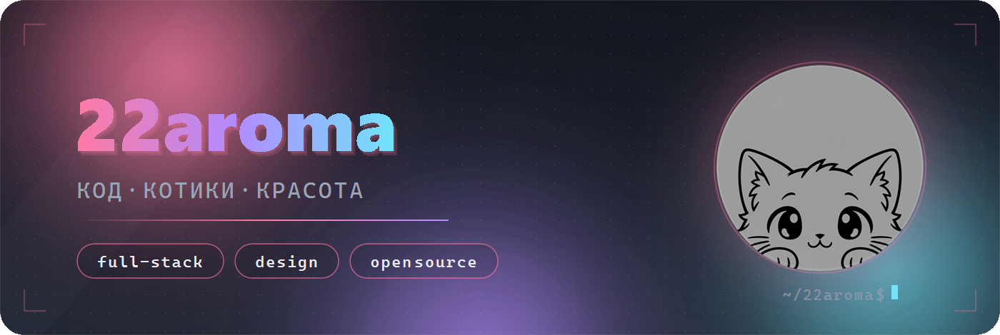
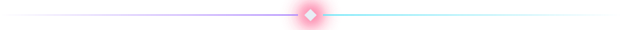
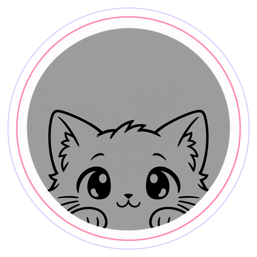
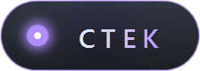

  

  

  
  
  
  

  

  

<table>
  <tr>
    <td width="270" valign="center" align="center">
      
    </td>
    <td valign="center">
      <h3>Hi! 👋 My name is <b>Roman</b></h3>
      
Делаю сайты и приложения от идеи до продакшена I make websites and desktop apps: interface, logic,
      design и deployment. I love clean code and polished animations.

    </td>
  </tr>
</table>

  

  
   
  
   
  

  <b>Frontend</b> · HTML, CSS, JavaScript 
  <b>Backend</b> · Python, Node.js, Django, Telegram 
  <b>Instruments</b> · Docker, Linux, Redis, Git, GitHub, Pylint, Pytest

  

  

<table>
  <tr>
    <td width="50%" align="center">
      
    </td>
    <td width="50%" align="center">
      
    </td>
  </tr>
</table>

<table>
  <tr>
    <td align="center">
      
    </td>
    <td align="center">
      
    </td>
  </tr>
</table>

  

  

<table>
  <tr>
    <td align="center">
      
    </td>
    <td align="center">
      
    </td>
    <td align="center">
      
    </td>
    <td align="center">
      
    </td>
  </tr>
</table>

  Open to new projects

  <picture>
    <source media="(prefers-color-scheme: dark)" srcset="https://raw.githubusercontent.com/22aroma/22aroma/main/assets/snake/snake-dark.svg">
    <source media="(prefers-color-scheme: light)" srcset="https://raw.githubusercontent.com/22aroma/22aroma/main/assets/snake/snake.svg">
    
  </picture>

  

  

  made with 😺 · 2026

